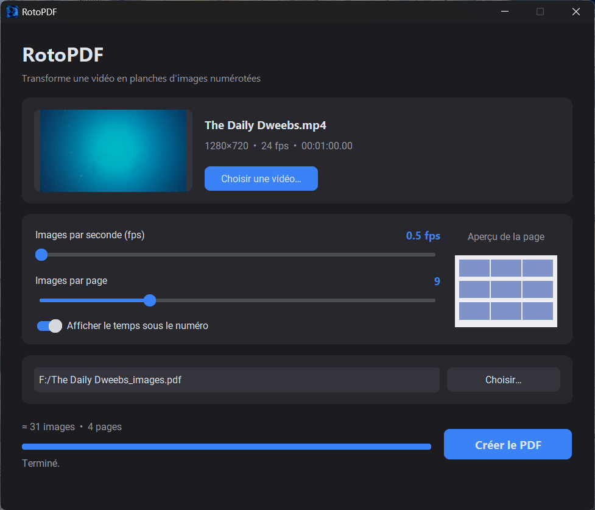
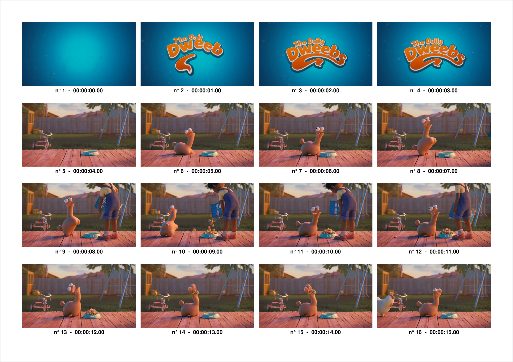

# RotoPDF

[English](README.md) | **Français**

**Un outil simple pour transformer des vidéos en planches d'images numérotées au format PDF, pensé pour préparer des références visuelles en animation, rotoscopie, storyboard et analyse vidéo.**



## Fonctionnement et fonctionnalités

RotoPDF extrait des images à une fréquence définie par l'utilisateur et les assemble automatiquement dans un document PDF prêt à être consulté, imprimé ou annoté :

- **Fréquence d'extraction réglable :** choix du nombre d'images par seconde (fps) à extraire.
- **Mise en page automatique :** choix du nombre d'images par page (avec aperçu visuel de la grille, orientation portrait ou paysage).
- **Repérage précis :** numérotation séquentielle de chaque image (`n° 1`, `n° 2`…), avec affichage facultatif du code temporel (`00:00:00.00`).
- **Interface sombre et hors ligne :** application autonome fonctionnant entièrement en local, fournie avec un installateur Windows.

## Cas d'utilisation

RotoPDF est un **outil de préparation et d'analyse visuelle** : il ne réalise pas lui-même le dessin, le montage ou la rotoscopie, mais génère rapidement des planches de travail structurées pour accompagner ces pratiques :

- **Rotoscopie :** extraire les images clés d'une séquence vidéo afin de constituer une planche de référence pour le dessin ou l'animation image par image.
- **Storyboard et découpage :** transformer une scène en planches numérotées pour étudier le rythme, les cadrages et l'enchaînement des plans.
- **Étude du mouvement :** décomposer un geste, une démarche ou une action mécanique à intervalles réguliers pour comparer les poses successives.
- **Analyse vidéo et pédagogie :** annoter ou commenter une séquence image par image sur tablette ou sur papier lors d'un cours, d'un atelier ou d'une revue de projet.

| Public | Exemple d'usage |
| :--- | :--- |
| **Animateurs 2D & étudiants** | Préparer des planches de référence et étudier la décomposition d'un mouvement |
| **Réalisateurs & storyboarders** | Analyser le découpage d'une scène existante ou documenter un tournage |
| **Monteurs vidéo** | Examiner rapidement le contenu d'un rush sans ouvrir un logiciel de montage |
| **Illustrateurs & artistes** | Constituer une banque de poses et d'expressions à partir d'une vidéo |
| **Enseignants & chercheurs** | Support imprimable ou annotable pour l'analyse de séquences vidéo |

## Exemple d'utilisation

Pour illustrer le rendu, la vidéo d'animation *The Daily Dweebs* (1280×720, 24 fps, durée 1 min 00) a été traitée avec les réglages suivants :

1. **Sélection de la vidéo :** ouverture de `The Daily Dweebs.mp4` dans RotoPDF.
2. **Paramétrage :** extraction réglée à **1 image par seconde** (ou **0,5 fps** pour une vue plus condensée) et affichage du temps activé sous chaque numéro.
3. **Génération :** création automatique d'un fichier PDF multi-pages avec grille régulière.

### Aperçu d'une planche PDF générée



> *Images extraites à titre d'exemple depuis le court métrage d'animation **The Daily Dweebs** (© Blender Foundation, sous licence [CC BY 4.0](https://creativecommons.org/licenses/by/4.0/)).*

## Installer

Télécharge `RotoPDF_Setup.exe` dans la section [**Releases**](../../releases) et lance-le.

### Avertissement Windows à l'installation

Les versions ne sont pas encore signées numériquement : Windows SmartScreen peut afficher *« Windows a protégé votre ordinateur »*. Clique sur **Informations complémentaires**, puis **Exécuter quand même**. L'empreinte SHA-256 de chaque installateur est publiée avec la Release (`RotoPDF_Setup.exe.sha256`) pour vérifier ton téléchargement.

## Lancer depuis le code source

```bash
pip install -r requirements.txt
python rotopdf.py
```

Ou double-clique sur `lancer.bat` (Windows).

## Construire l'installateur (Windows)

1. Installe Python 3.10 ou plus récent et [Inno Setup](https://jrsoftware.org/isdl.php) (gratuit, version 6 ou 7).
2. Double-clique sur `creer_installateur.bat`.
3. L'installateur est créé dans `Output\RotoPDF_Setup.exe`.

`creer_exe.bat` crée à la place un exécutable portable unique (`dist\RotoPDF.exe`). Les Releases sont aussi construites automatiquement par GitHub Actions (`.github/workflows/build.yml`).

## Politique de signature du code (Code Signing Policy)

Une candidature au programme gratuit de signature de code de la fondation SignPath est prévue. Si elle est acceptée, les versions Windows seront construites automatiquement par GitHub Actions depuis ce dépôt public puis signées : *« Free code signing provided by SignPath.io, certificate by SignPath Foundation »*.

- **Auteur, relecteur et approbateur :** Mattt6
- **Confidentialité :** ce programme fonctionne hors ligne et ne transmet aucune information à d'autres systèmes en réseau.

## Crédits

Développé par Mattt6 avec l'aide de Claude (Anthropic).

## Licence

Copyright (C) 2026 Mattt6

Publié sous licence GNU GPL v3 ou ultérieure, voir [LICENSE](LICENSE).
Les composants tiers sont listés dans [THIRD_PARTY_NOTICES.txt](THIRD_PARTY_NOTICES.txt).
