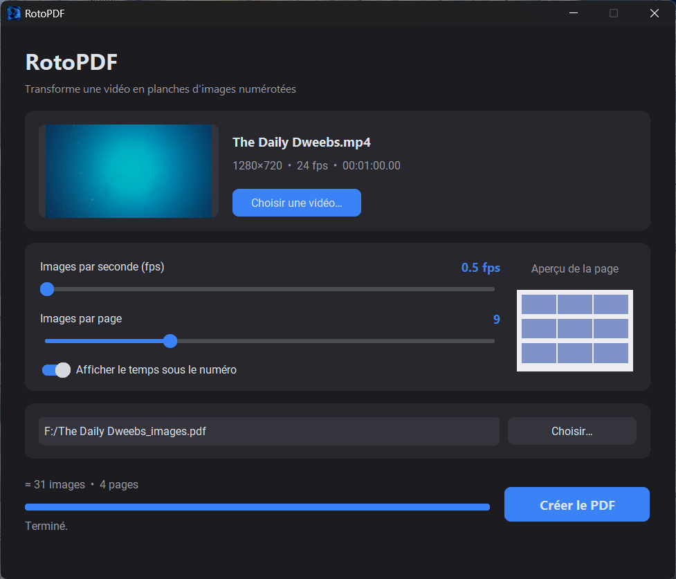
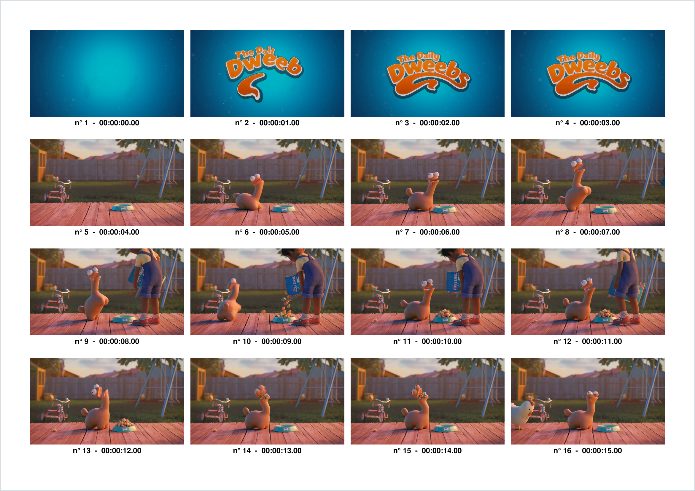

# RotoPDF

**English** | [Français](README.fr.md)

**A simple tool to turn videos into numbered visual reference sheets in PDF format for animation, rotoscoping, storyboarding, and video analysis.**



## How It Works & Features

RotoPDF extracts frames from a video at a user-defined rate and automatically arranges them into a clean PDF document ready to view, print, or annotate:

- **Adjustable extraction rate:** Choose how many frames per second (fps) to extract.
- **Automatic grid layout:** Choose how many images per page (with live grid preview, portrait or landscape orientation).
- **Clear frame indexing:** Sequential numbering on every frame (`n° 1`, `n° 2`…), with optional video timestamp (`00:00:00.00`).
- **Dark UI & offline-first:** Standalone local desktop application with a Windows installer provided.

## Use Cases

RotoPDF is a **visual preparation and analysis tool**: it does not perform drawing, editing, or rotoscoping itself, but quickly generates structured contact sheets to support those workflows:

- **Rotoscoping:** Extract key frames from live-action or animated footage to build reference sheets for frame-by-frame drawing and animation.
- **Storyboarding & shot breakdown:** Turn a video sequence into numbered image sheets to study pacing, framing, and scene progression.
- **Motion study:** Break down a gesture, walk cycle, or physical action at regular intervals to compare consecutive poses.
- **Video analysis & teaching:** Print or annotate a sequence frame-by-frame on a tablet or paper for classes, workshops, or project reviews.

| Audience | Example Use Case |
| :--- | :--- |
| **2D animators & students** | Prepare reference sheets and study frame-by-frame motion |
| **Directors & storyboard artists** | Break down an existing scene or document a shoot |
| **Video editors** | Quickly inspect footage contents without opening an NLE |
| **Illustrators & artists** | Build a pose and expression reference library from video |
| **Teachers & researchers** | Printable or annotatable reference sheets for video analysis |

## Usage Example

To illustrate the workflow, the animated short *The Daily Dweebs* (1280×720, 24 fps, 1:00 runtime) was processed with the following settings:

1. **Select video:** Open `The Daily Dweebs.mp4` in RotoPDF.
2. **Configure extraction:** Set extraction rate to **1 frame per second** (or **0.5 fps** for a more condensed sheet) and enable timestamps below each frame number.
3. **Export:** Generate a multi-page PDF contact sheet with an automatic grid layout.

### Sample Generated PDF Sheet



> *Sample frames extracted from the animated short **The Daily Dweebs** (© Blender Foundation, licensed under [CC BY 4.0](https://creativecommons.org/licenses/by/4.0/)).*

## Install

Download `RotoPDF_Setup.exe` from the [**Releases**](../../releases) section and run it.

### Windows warning at install time

Releases are not digitally signed yet, so Windows SmartScreen may show *"Windows protected your PC"*. Click **More info**, then **Run anyway**. The SHA-256 checksum of each installer is published with the release (`RotoPDF_Setup.exe.sha256`) so you can verify your download.

## Run from source

```bash
pip install -r requirements.txt
python rotopdf.py
```

Or double-click `lancer.bat` (Windows).

## Build the installer (Windows)

1. Install Python 3.10 or newer and [Inno Setup](https://jrsoftware.org/isdl.php) (free, version 6 or 7).
2. Double-click `creer_installateur.bat`.
3. The installer is created in `Output\RotoPDF_Setup.exe`.

`creer_exe.bat` builds a single portable exe instead (`dist\RotoPDF.exe`). Releases are also built automatically by GitHub Actions (`.github/workflows/build.yml`).

## Code Signing Policy

An application to the free code signing program of the SignPath Foundation is planned. If it is accepted, Windows releases will be built automatically by GitHub Actions from this public repository and then signed: *"Free code signing provided by SignPath.io, certificate by SignPath Foundation"*.

- **Author, reviewer and approver:** Mattt6
- **Privacy:** this program works offline and does not transfer any information to other networked systems.

## License

Copyright (C) 2026 Mattt6

Released under the GNU GPL v3 or later, see [LICENSE](LICENSE).
Third-party components are listed in [THIRD_PARTY_NOTICES.txt](THIRD_PARTY_NOTICES.txt).
